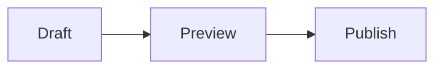
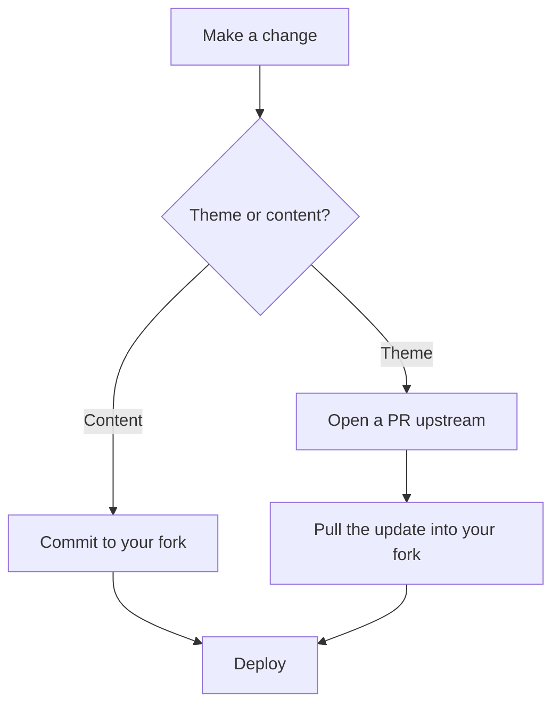
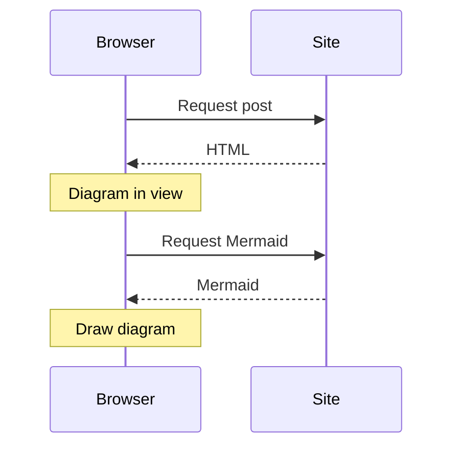
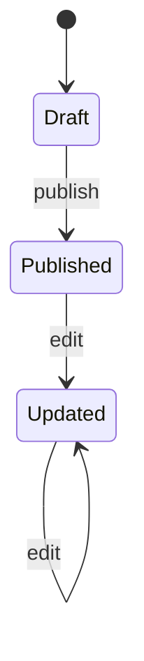
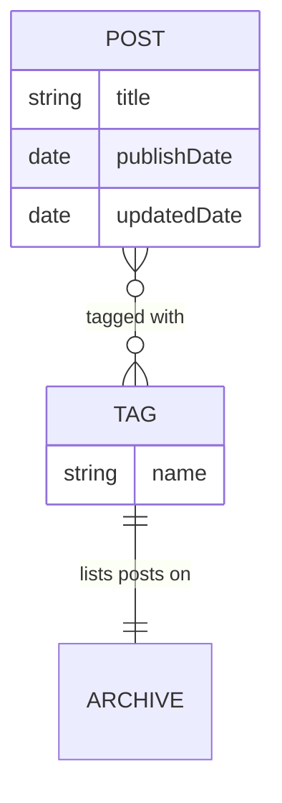

Write a diagram as text in a code fence labelled `mermaid`, in any `.md` or `.mdx` post. No import, no component, no
build step. The diagram is drawn in the browser, in the site's colours, and redrawn when you switch between light and
dark.

````markdown

````


## Flowcharts

Use `TD` for top-down and `LR` for left-to-right. Square brackets make boxes, curly braces make decisions, and text
between pipes labels an edge.



## Sequence diagrams

Good for requests, handshakes and anything else that happens in order between a few parties.



## State diagrams



## Entity relationships



Mermaid supports more diagram types than these, including class diagrams, Gantt charts, pie charts, mind maps and
git graphs. See the [Mermaid documentation](https://mermaid.js.org/intro/) for the full syntax.

## How it loads

- Only posts that contain a diagram include the loader script. Other posts ship no diagram code at all.
- Mermaid itself is downloaded from the site's own assets when the first diagram comes within 200px of the viewport,
  so a diagram at the bottom of a long post costs nothing until the reader gets near it.
- Diagram source is excluded from site search, so the search index only holds the prose around it.

## Writing good diagrams

- Add `accTitle` and `accDescr` to every diagram. Screen readers read them in place of the drawing.
- Keep diagrams narrow. Small diagrams shrink to fit a phone screen; wide ones scroll sideways inside their frame.
- Without JavaScript, or if the syntax is invalid, the source text stays on the page, so it should read sensibly on its
  own. Errors are logged to the browser console.
